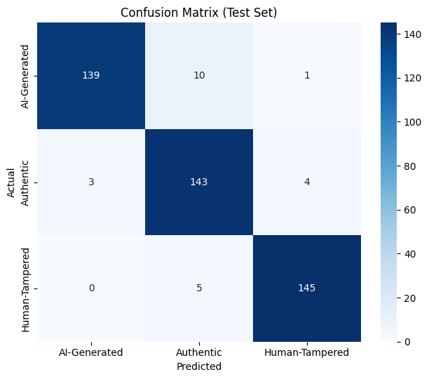
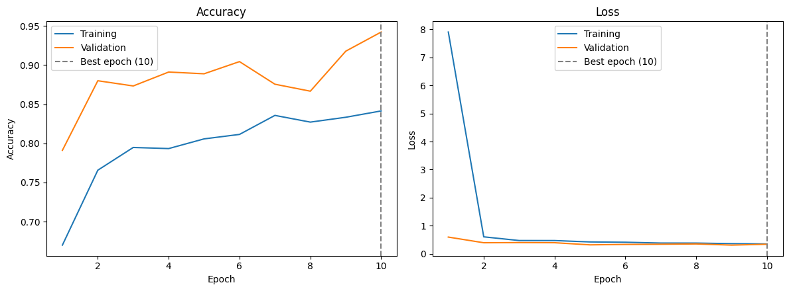

# Authenticity Detection of Digital Receipts

A VGG19-based deep learning model that classifies GCash and Maya peer-to-peer receipt screenshots as **authentic**, **human-tampered**, or **AI-generated**.

[](https://colab.research.google.com/github/spidermonsi/receipt-authenticity-vgg19/blob/main/receipt_authenticity_vgg19.ipynb)

> Undergraduate thesis, BS Computer Science, National University Laguna, Philippines.

## Overview

Most prior work on receipt forgery treats the problem as binary: genuine or forged. This project treats it as a three-class problem, so the model also has to tell manual edits apart from images produced by generative AI. Grad-CAM is included as a supplementary check on which regions of a receipt the model relies on.

| Class | Description |
|---|---|
| Authentic | Unaltered GCash or Maya receipt screenshots |
| Human-tampered | Authentic receipts manually edited |
| AI-generated | Receipts produced or altered with image generation tools (ChatGPT and Gemini) |

**Scope:** peer-to-peer transaction receipts from GCash and Maya only. Other receipt types and platforms are out of scope.

## Method

- **Dataset:** 3,000 images, 1,000 per class (500 GCash and 500 Maya per class)
- **Standardization:** every image is converted to an RGB PNG, shrunk with Lanczos resampling while keeping its aspect ratio, and centered on a white 224 x 448 (W x H) canvas
- **Split:** stratified 70/15/15 with seed 42 (700 / 150 / 150 images per class)
- **Backbone:** VGG19 pretrained on ImageNet, frozen, used as a feature extractor
- **Head:** Flatten, Dense 256 (ReLU), Dropout 0.5, Dense 3 (softmax)
- **Input:** 448 x 224 (H x W), VGG19 `preprocess_input`, no data augmentation
- **Training:** Adam, learning rate 5e-4, batch size 32, up to 10 epochs, early stopping on validation accuracy (patience 5) with the best checkpoint kept
- **Size:** 32.87M parameters in total, 12.85M trainable
- **Evaluation:** accuracy, per-class precision, recall, F1, confusion matrix, and a dedicated analysis of human-tampered vs. AI-generated confusions

## Results

Test set, 450 images (150 per class):

| Class | Precision | Recall | F1-score |
|---|---|---|---|
| AI-Generated | 97.89% | 92.67% | 95.21% |
| Authentic | 90.51% | 95.33% | 92.86% |
| Human-Tampered | 96.67% | 96.67% | 96.67% |
| **Overall accuracy** | | | **94.89%** |
| Macro average | 95.02% | 94.89% | 94.91% |



Separating the two forgery types worked well: no human-tampered receipt was labeled AI-generated, and 1 of 150 AI-generated receipts was labeled human-tampered. The model labeled 15 of 300 forgeries (5.00%) as authentic.



## Repository structure

```
.
├── receipt_authenticity_vgg19.ipynb   Training, evaluation, Grad-CAM, and the upload prototype
├── requirements.txt
├── .gitignore
├── assets/                            Figures used in this README
└── README.md
```

The dataset and the trained model file are not stored in this repository. See below.

## Getting started

The notebook is written for Google Colab with a GPU runtime and Google Drive.

1. Click the **Open in Colab** badge above.
2. Run **Section 1** (setup and configuration) and allow Drive access when asked.
3. To retrain, place your dataset in `THESIS/DATASET/` on Drive (see **Dataset**) and run the sections in order.
4. To only try the model, skip to **Try the prototype**.

To run outside Colab, install `requirements.txt`, then replace the Drive mount and `BASE_DIR` in Section 1 and the upload step in Section 14.

## Try the prototype

Section 14 of the notebook lets you upload a receipt screenshot and see the prediction.

1. Download `thesis_model.keras` (see **Model weights**) and put it at the `MODEL_PATH` set in Section 1.
2. Run Section 1, then run the Section 14 cell. You do not need the dataset for this.
3. Choose one or more images. For each one the notebook shows the image as the model sees it, the predicted class, and the probability of each class.

Uploads go through the same standardization as the training data. The model only knows GCash and Maya peer-to-peer receipts, so an image of anything else will still get one of the three labels, and that label means nothing.

## Model weights

`thesis_model.keras` is about 125 MB, which is over GitHub's 100 MB file limit, so it is hosted outside the repository.

- Download: <!-- add your GitHub Releases or Google Drive link here -->

## Dataset

The dataset is not published. Real receipt screenshots can contain names, mobile numbers, and transaction details of real people. Researchers who want access for replication may contact the authors.

Expected folder layout:

```
DATASET/
├── AI_GENERATED/
├── AUTHENTIC/
└── HUMAN_TAMPERED/
```

## Limitations

- Trained and tested only on GCash and Maya peer-to-peer receipts.
- Forged samples were made with a limited set of tools (manual editing, ChatGPT, and Gemini). Other generators and editing methods are untested.
- A metadata-only baseline (Section 5) reaches 82% validation accuracy from file size alone, so file-level cues exist in the dataset and the reported accuracy may partly reflect them.
- Results come from one dataset collected by the authors and have not been validated on receipts collected elsewhere.
- Images are resized to a fixed shape, which can reduce the visibility of small text.

## Authors

- John Simon Ray Umadac
- Christian De Ocampo
- Adrienne Ghabriel Xander Pagaran

Thesis adviser: Michael Casabuena

